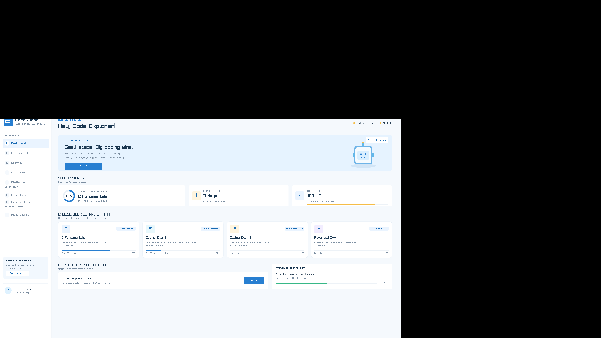

# CodeQuest

An interactive C / C++ learning and revision app, written in C99 with [raylib](https://www.raylib.com/).

CodeQuest is the next version of **CExam Trainer**. It keeps the same toolchain
(C99, raylib's bundled gcc, `build.bat` / `Makefile`) and the same exam
question bank and marking engine, inside a friendlier blue-and-white app with
learning paths, lessons, quizzes, mock exams and saved progress.



---

## What's in it

| Screen | What it does |
|---|---|
| **Dashboard** | Your current path, streak, XP and level, all four paths, the next lesson and today's mini quest. |
| **Learning Path** | The four paths and their lessons. *Learn C* and *Learn C++* in the sidebar open their path directly. |
| **Lesson** | Notes, a highlighted code example and a key point, then a check: score 50% or more to complete the lesson. |
| **Quiz** | Multiple choice for C Fundamentals and Advanced C++; real exam questions for the Coding Exam paths: **Section A** (type exactly what the code prints) and **Section B** (fill in the blanks). |
| **Exam Arena** | Timed mock papers for Coding Exam 1 (Labs 1–2) and 2 (Lab 3): a 10-question quick mock or the full paper. Best scores are saved. |
| **Challenges** | Untimed drills (output sprint, fill the blanks, mixed) for one lab or all of them. |
| **Revision Centre** | Mastery per lab, a drill of the questions you have got wrong, and every lecture note with its example. |
| **Achievements** | 12 badges, your overall stats, and a reset button. |
| **Ask the robot** | A pop-up of study tips from the sidebar. |

### The four paths

| Path | Content |
|---|---|
| C Fundamentals | 20 lessons from `main` to files, each with a 2-question check |
| Coding Exam 1 | 9 practice sets built from the Lab 1–2 lecture notes and exam questions, then a timed mock |
| Coding Exam 2 | Lab 3 pointer and string sets, structs and `malloc` lessons, then a timed mock |
| Advanced C++ | 10 lessons from references and classes to virtual functions and the STL |

### Progress and XP

- Completing a lesson: **+50 XP** (first time). Each fully correct answer: **+10 XP**.
- Finish 2 quizzes in a day for the mini quest's **+20 XP** bonus. Any finished quiz keeps your streak going.
- A new level every 250 XP.
- Saved next to the executable in two plain-text files, written after every change:
  `codequest.sav` (lessons, XP, streak, best scores) and `progress.txt`
  (per-question history, the same format as CExam Trainer).

---

## Project layout

```
src/
  main.c            window, main loop, navigation (app.h)
  app.h             screens, and how screens ask main.c to change screen
  ui.c/.h           palette, buttons, progress bars/rings, badges, text, scroll, toast, robot
  codeview.c/.h     syntax-highlighted code and the answer text box (from CExam Trainer)
  sidebar.c/.h      left-hand navigation
  paths.c/.h        the four learning paths and their lesson list
  lessons.c/.h      lesson notes, examples, multiple-choice checks, exam question lists
  content.c/.h      exam question bank and lecture notes (from CExam Trainer)
  quiz.c/.h         quiz building and marking (from CExam Trainer)
  progress.c/.h     per-question history (from CExam Trainer)
  save.c/.h         lessons done, XP, levels, streak, quest, best mock scores
  dashboard.c       home screen
  learnpath.c       learning path screen
  lesson.c          lesson screen
  quizscreen.c      quiz and results screen
  arena.c  challenges.c  revision.c  achievements.c  robot.c   (screens.h)
tools/verify.c      recomputes every Section A answer
build.bat           one-click Windows build
Makefile            make / run / debug / shots / verify / clean
shots/              screenshots (regenerate with `make shots`)
```

## Building

Install raylib for Windows (it puts gcc in `C:\raylib\w64devkit`). Then, from this folder:

```bat
build.bat          :: build only
build.bat run      :: build then launch
```

or with make: `make run`. If raylib is somewhere other than `C:\raylib`,
set `RAYLIB_DIR` first:

```bat
set RAYLIB_DIR=D:\path\to\raylib
```

The executable is `build\CodeQuest.exe`. `make shots` uses built-in demo
progress and never touches your real save. To launch from Visual Studio,
open the terminal (View > Terminal) and type `.\build.bat run`.
